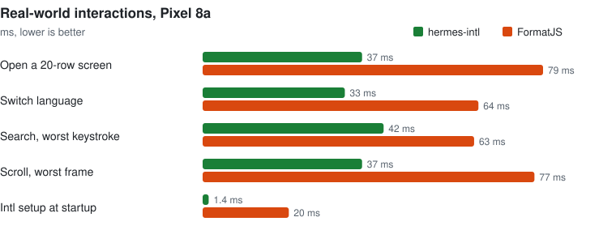
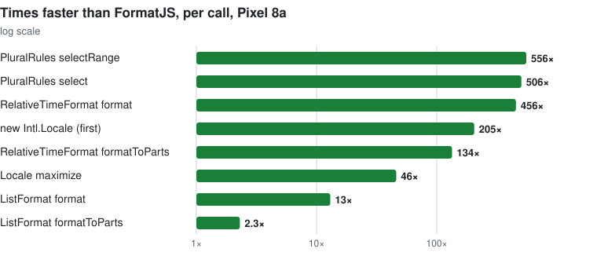

<a href="https://www.linkedin.com/in/jeremy-magrin/">
  
</a>

# hermes-intl

<a href="https://useffect.sh/seal/magrinj/hermes-intl"></a>

[](https://www.npmjs.com/package/hermes-intl)
[](LICENSE)

[](https://github.com/magrinj/hermes-intl/actions/workflows/ci.yml)


Native `Intl.PluralRules`, `Intl.RelativeTimeFormat`, `Intl.ListFormat`, `Intl.Segmenter`, `Intl.DisplayNames`, `Intl.DurationFormat` and `Intl.Locale` for
React Native's [Hermes](https://github.com/facebook/hermes) engine, backed by
[ICU4X](https://github.com/unicode-org/icu4x), and on iOS a full `Intl.NumberFormat` in place of
Hermes's own. A drop-in replacement for the [FormatJS](https://formatjs.github.io/) polyfills.

## Why this library?

- **Fast.** `PluralRules.select` and `RelativeTimeFormat.format` are 200 to 800 times faster than
  the FormatJS polyfills.
  Screens that format dates and counts open about twice as fast, and the worst frame of a fast
  scroll is half as long.
- **Correct, and the same everywhere.** It passes test262 for these APIs (4 known failures, listed
  [below](#whats-included)) and gives byte-identical output on iOS and Android. FormatJS output depends
  on the platform, and its plurals for decimals are wrong in some languages.
- **Drop-in.** It installs the standard `Intl` constructors, so code and libraries that use them
  (i18next, react-intl, Luxon) pick it up without changes. The app ships ~400 KB less JavaScript
  and 8.0 to 8.8 MB more native code per Android ABI, 10.6 MB on iOS, most of it the names of every
  language, region and currency in 514 locales ([fewer locales](#locales-and-size) make it much
  smaller).

## Benchmarks

Pixel 8a, release builds of the same app with hermes-intl and with FormatJS ([example/](example/)):

<picture>
  <source media="(prefers-color-scheme: dark)" srcset=".github/assets/chart-interactions-dark.svg">
  
</picture>

<picture>
  <source media="(prefers-color-scheme: dark)" srcset=".github/assets/chart-speedup-dark.svg">
  
</picture>

Measured from the outside with [Flashlight](https://github.com/bamlab/flashlight), a fast scroll
scores **94/100 with hermes-intl and 62 with FormatJS**, which keeps the JS thread saturated for
3.6 of the 5 seconds.

The charts are from 2026-09-30. Timings move with the phone's state: a re-run the next day, with the
phone charging and cooler, sped up both builds and FormatJS more, for 200 to 385 times per call and
89 times on 10,000 notifications ([re-run](bench/README.md#re-run-on-2026-10-01)).

Every number, the other devices, conformance and how to reproduce: [bench/README.md](bench/README.md).

## Installation

```sh
npm install hermes-intl   # or: bun add hermes-intl / yarn add hermes-intl
cd ios && pod install
```

Import it on the first line of your entry file, before anything that uses `Intl`:

```js
// index.js
import 'hermes-intl';
```

Then remove `@formatjs/intl-pluralrules`, `intl-relativetimeformat`, `intl-listformat`,
`intl-segmenter`, `intl-displaynames`, `intl-durationformat`, `intl-locale` and `intl-getcanonicallocales` from your app.

**Requirements:** React Native 0.86+ with the New Architecture and Hermes (the default engine). Expo works with a
development build (`npx expo prebuild`), not Expo Go. Tested on React Native 0.87.1 and Expo SDK 57.

## Usage

Nothing to learn: it is the standard API.

```js
new Intl.PluralRules('pl').select(3); // "few"
new Intl.RelativeTimeFormat('fr', { numeric: 'auto' }).format(-1, 'day'); // "hier"
new Intl.ListFormat('en', { type: 'conjunction' }).format(['Anna', 'Omar', 'Yuki']); // "Anna, Omar, and Yuki"
[...new Intl.Segmenter().segment('👨‍👩‍👧 ok')].length; // 4: the family emoji is one grapheme
new Intl.DisplayNames('fr', { type: 'region' }).of('DE'); // "Allemagne"
new Intl.DurationFormat('en', { style: 'digital' }).format({ hours: 1, minutes: 2 }); // "1:02:00"
new Intl.Locale('ar-EG').maximize().getWeekInfo(); // { firstDay: 6, weekend: [5, 6] }
```

With i18next, plurals just work:

```js
i18n.t('likes', { count: 3 }); // likes_few in Polish, likes_other in English
```

### Worklets

With [react-native-worklets](https://docs.swmansion.com/react-native-worklets/) (Reanimated 4) and
its Babel plugin (tested with 0.13), install the same constructors on a worklet runtime:

```js
import { installOnWorkletRuntime } from 'hermes-intl';

installOnWorkletRuntime();        // the UI runtime
installOnWorkletRuntime(runtime); // one from createWorkletRuntime
```

## What's included

| API | Notes |
| --- | --- |
| `Intl.PluralRules` | `select`, `selectRange`, `resolvedOptions`; all digit options, `notation` (incl. compact) |
| `Intl.RelativeTimeFormat` | `format`, `formatToParts`, `numeric: "auto"`, every numbering system with simple digits (`-u-nu-`) |
| `Intl.ListFormat` | conjunction / disjunction / unit, long / short / narrow, `formatToParts` |
| `Intl.Segmenter` | grapheme, word (with `isWordLike`) and sentence segments, `containing`; words in Chinese, Japanese, Thai, Lao, Khmer and Burmese use ICU4X's dictionaries and models |
| `Intl.DisplayNames` | names of languages (dialect or standard), regions, scripts, currencies, calendars and date-time fields; long / short / narrow, `fallback` |
| `Intl.DurationFormat` | long / short / narrow / digital, every per-unit style and display option, `fractionalDigits`, `formatToParts`; exact arithmetic on the units |
| `Intl.Locale` | all getters, `maximize`, `minimize`, and the Locale Info methods (`getWeekInfo`, `getTextInfo`, `getCalendars`, `getHourCycles`, `getNumberingSystems`, `getTimeZones`, `getCollations`) |
| `Intl.getCanonicalLocales` | replaced so it accepts `Intl.Locale` objects |
| `Intl.supportedValuesOf` | calendars, collations, currencies, numbering systems, time zones and units; the values Hermes's own constructors take are checked on first use |
| `Intl.NumberFormat`, `Number` and `BigInt` `toLocaleString` | on iOS, replaced: Hermes's own there has no `formatToParts` and ignores compact notation, `signDisplay`, `roundingMode` and `-u-nu-`. Every option, `formatToParts`, `formatRange`, `formatRangeToParts`. On Android, Hermes's own, wrapped so it accepts an `Intl.Locale` object |
| `Intl.DateTimeFormat`, `Collator`, `Date` `toLocale*String`, `localeCompare` | Hermes's own, wrapped so they accept an `Intl.Locale` object as the locale |

Each constructor is installed only if Hermes lacks it. On other engines (JSC, web) the import does
nothing. Conformance: 1,892 of 1,900 test262 `intl402` runs pass for these APIs (each test runs in
sloppy and strict mode). The 8 others are 4 known failures: 2 where a test checks Hermes's own
`DateTimeFormat` or `Collator`, historic currencies that `DisplayNames` names but
`supportedValuesOf` leaves out (as V8 does), and a locale outside the shipped set.

## Locales and size

The binaries include ICU4X's recommended set of 514 locales
([list](rust/locales/recommended.txt)). A locale outside the set falls back to its parent
(`fr-XX` → `fr`), then to the device locale, like any `Intl` implementation.

| Platform | Native size added |
| --- | --- |
| Android | 8.8 MB (arm64-v8a), 8.0 MB (armeabi-v7a), 8.8 MB (x86_64), 8.2 MB (x86) |
| iOS | 10.6 MB (arm64 device) |

Of that, `Intl.DisplayNames` takes about 4.5 MB (the names of every language, region, script and
currency, in each of the 514 locales), `Intl.Segmenter` 2.4 MB (almost all the Chinese and Japanese
word dictionary) and, on iOS, `Intl.NumberFormat` 2.3 MB (currency names, compact and unit
patterns).

To ship only your app's locales (about 3.5 MB per ABI for 5, the Segmenter dictionary
included), build the binaries yourself: see [CONTRIBUTING.md](.github/CONTRIBUTING.md#custom-locale-set).

## Not included (yet)

- `Intl.DateTimeFormat` and `Collator` replacements: Hermes's own are kept.

## Differences from V8 worth knowing

- On iOS, a compact currency amount puts the locale's currency pattern around the compact number
  ("1,2 M €" in Spanish where V8 has "1,2 M€"): CLDR's compact currency patterns are not bundled.
- On iOS, English in continental Europe (en-150, en-DE, en-BE...) formats currencies with its CLDR
  pattern ("1.234,50 €" in en-DE), where V8's ICU uses English's ("€1,234.50").

- `new Intl.RelativeTimeFormat("en", { numeric: "auto" }).format(0.9999, "day")` is "in 1 day"
  (the spec: the value is not exactly 1); V8 rounds first and says "tomorrow".
- `getHourCycles()` and `getCalendars()` use compact CLDR tables; ICU4X ships no hour-cycle data.
- `getCollations()` returns the spec's fallback list, as no collation data is bundled.
- `Intl.Segmenter` splits Japanese and Chinese words with ICU4X's dictionary, which differs from
  ICU's in places, keeps a Khmer consonant cluster (`ស្តី`) in one grapheme where V8 splits it,
  and counts a lone `_` as a word.
- `Intl.DisplayNames` uses CLDR 48 where Node 22 has CLDR 47, so a few names differ ("hindi" in
  Portuguese, the new Caribbean guilder). As in V8, currency names ignore `style`.
- `Intl.DurationFormat` follows the spec where V8 differs: units are added exactly
  (`{ seconds: 10000000, nanoseconds: 1 }` ends in `.000000001`, not `.000000002`), a numeric
  unit after a text one is a list item (`1 hr, 2 min, 3`, as in Safari, not `1 hr, 2 min:3`), and
  hours have two digits in the digital style where CLDR says so (`01:02:03` in Afrikaans).
- A single realm is assumed, as in React Native: subclassing across realms (`Reflect.construct`
  with a `newTarget` from another realm) uses this realm's prototypes.

## How it works

1. A C++ TurboModule (`cpp/`) exposes a few host functions over a Rust core (`rust/`) built on
   ICU4X, with locale data compiled in.
2. A small JS layer (`js/bootstrap.js`, bundled and precompiled to bytecode with your app) builds
   spec-exact constructors on top: prototypes, property descriptors, option reading order,
   validation, `formatToParts` objects.
3. Setup costs under 2 ms on a Pixel 8a; locale data is loaded on first use of each constructor.

[ARCHITECTURE.md](ARCHITECTURE.md) covers the design, how the library is injected at startup and
what a call goes through.

## Example app

[example/](example/) is the demo and benchmark app: a notification feed built twice, with
hermes-intl and with FormatJS, installable side by side, with an FPS meter and timed real-world
interactions.

## Contributing

See [CONTRIBUTING.md](.github/CONTRIBUTING.md).

## Acknowledgements

- [Hermes](https://github.com/facebook/hermes) and [React Native](https://reactnative.dev), by Meta
  and the open source community. hermes-intl only adds the `Intl` constructors Hermes does not ship;
  Hermes's own `NumberFormat`, `DateTimeFormat` and `Collator` stay in charge.
- [ICU4X](https://github.com/unicode-org/icu4x) and the Unicode CLDR, for the algorithms and the
  locale data.
- [test262](https://github.com/tc39/test262), the TC39 suite the implementation is checked against.
- [FormatJS](https://formatjs.github.io/), the polyfills used as the baseline in the benchmarks.
- Tzvetan Mikov's [Intl plugin for Hermes](https://github.com/tmikov/hermes/tree/hermes-intl):
  comparing with it showed that locales with a script (sr-Latn, bs-Cyrl) fell back to root's
  plural rules, and how to read the right ones.

hermes-intl is an independent project, not affiliated with or endorsed by Meta or the Hermes team.

## Support

If you find this library useful, consider supporting its development:

<a href="https://buymeacoffee.com/magrinj" target="_blank">
  
</a>

## License

[MIT](LICENSE). Bundled ICU4X code and data are under the Unicode License v3; see
[THIRD_PARTY_NOTICES.md](THIRD_PARTY_NOTICES.md).

---

<p align="center">
  Made with ❤️ by <a href="https://www.linkedin.com/in/jeremy-magrin/">Jérémy Magrin</a>, part of <a href="https://useffect.sh">useffect.sh</a>, a collective of senior React Native engineers
</p>

<p align="center">
  If you find this useful, please star it ⭐, it helps a lot!
</p>
